<p align="center">
  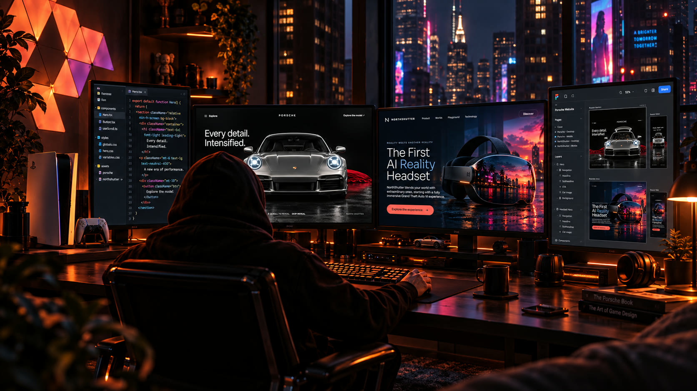
</p>

<h1 align="center">Darkroom</h1>

<h3 align="center">Type <code>/darkroom</code>. Say what you want.<br>Get a designed website, built on the platform you need.</h3>

<p align="center">
  <a href="https://alexandruiftimi-ns.github.io/darkroom-showcase/"></a>
  <a href="CHANGELOG.md"></a>
  <a href="LICENSE"></a>
  
  
  
  
</p>

<p align="center">
  <a href="#see-it">🎬 <b>See it</b></a> &nbsp;·&nbsp;
  <a href="#live-demos">🌐 <b>Live demos</b></a> &nbsp;·&nbsp;
  <a href="#platforms">🧱 <b>Platforms</b></a> &nbsp;·&nbsp;
  <a href="#redesign">♻️ <b>Redesign</b></a> &nbsp;·&nbsp;
  <a href="#questions">💬 <b>How it asks</b></a> &nbsp;·&nbsp;
  <a href="#looks">✨ <b>Looks & motion</b></a> &nbsp;·&nbsp;
  <a href="#prompts">🗣️ <b>Prompts</b></a> &nbsp;·&nbsp;
  <a href="#proof">✅ <b>Proof</b></a> &nbsp;·&nbsp;
  <a href="#install">🚀 <b>Install</b></a>
</p>

<p align="center">
  &nbsp;&nbsp;
  &nbsp;&nbsp;
  &nbsp;&nbsp;
  &nbsp;&nbsp;
  <picture><source media="(prefers-color-scheme: dark)" srcset="assets/icons/nextdotjs-light.svg"></picture>&nbsp;&nbsp;
  &nbsp;&nbsp;
  &nbsp;&nbsp;
  <picture><source media="(prefers-color-scheme: dark)" srcset="assets/icons/ghost-light.svg"></picture>&nbsp;&nbsp;
  &nbsp;&nbsp;
  
</p>

Darkroom is a [Claude Code](https://claude.com/claude-code) skill that turns Claude into **your art director and developer**. You bring the facts, your photos and your taste. Darkroom picks the design, writes the code **on the platform you need**: a Shopify store, a WooCommerce shop, a WordPress site you can edit, Astro on Cloudflare, Next.js on Vercel, Hugo, Jekyll, a Ghost publication, PHP, or plain HTML you can host for free. Then it **opens the result in a real browser, screenshots it, audits it and fixes what it sees.** The preview you have open reloads by itself as it works, and when it waits for something (clips you are making in an AI tool, a site starting up) it carries on the moment they arrive, without being nudged. You need no design vocabulary: ask for "animations when I scroll" and it answers in plain words, with one recommendation and a short list of what it needs from you.

> [!IMPORTANT]
> Darkroom **only starts when you type `/darkroom`**. Mentioning websites in another task never starts it by accident. Put what you want after the command, then just talk normally. In a new session, type `/darkroom` again and it continues where you left off. [How to ask for changes later ↓](#changes)

---

<a id="see-it"></a>

## 🎬 See it

<p align="center">
  <a href="assets/darkroom-showcase.mp4">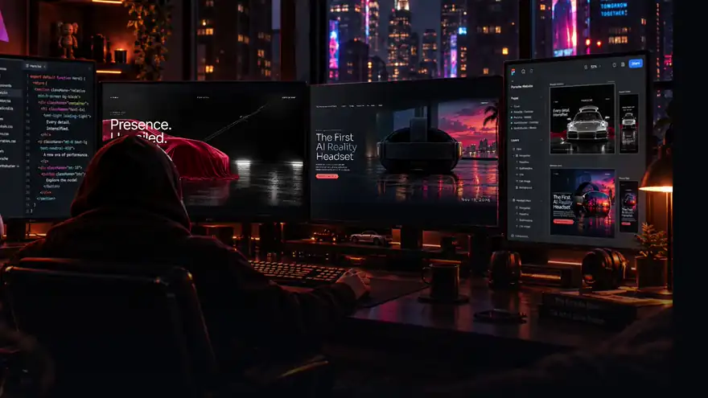</a>
  <br><sub>▶ Silent preview. <a href="assets/darkroom-showcase.mp4"><b>Open the full film with sound</b></a> (24 s, 720p).</sub>
</p>

<table>
  <tr>
    <td width="50%">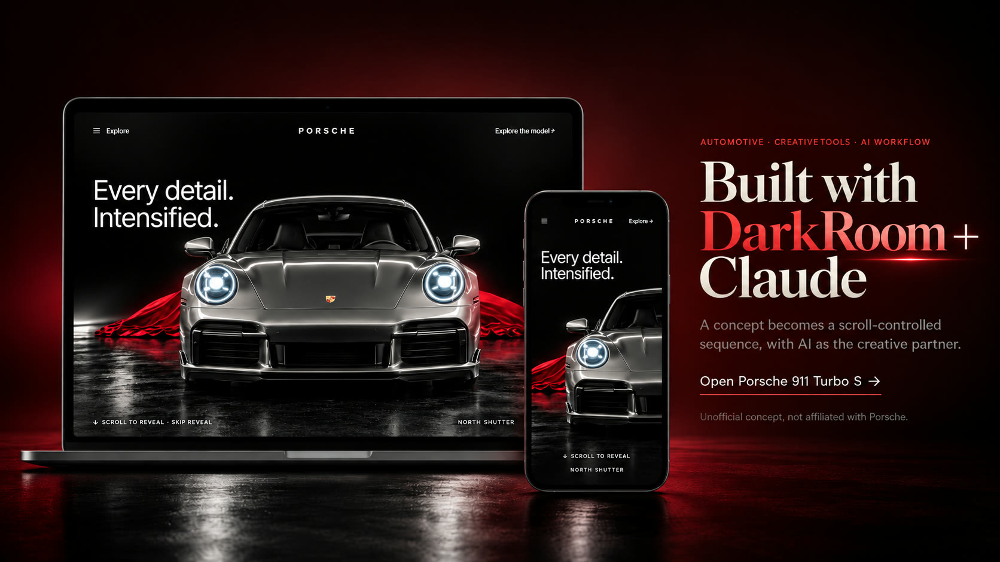<br><sub><b>Porsche 911 Turbo S (concept)</b> · look: cinematic · motion: <b>one hero effect</b><br>A supplied film becomes a scroll-controlled frame sequence, with a configurator.</sub></td>
    <td width="50%">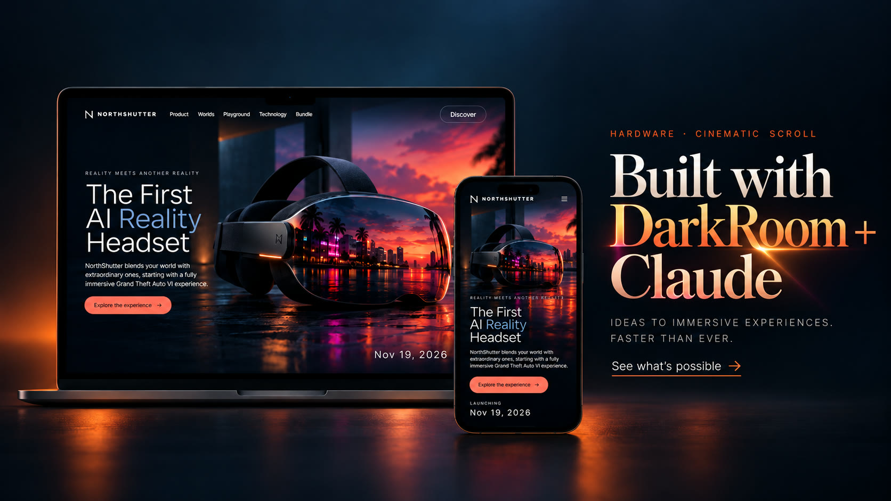<br><sub><b>NorthShutter AI Reality (concept)</b> · look: cinematic · motion: <b>scroll story</b><br>A hero film scrubbed by scroll, a lens dive, eight cinematic beats.</sub></td>
  </tr>
</table>

<sub>Both are <b>unofficial fictional concepts</b>, not affiliated with Porsche, Rockstar Games or Take-Two Interactive. The laptop and phone frames are AI-generated presentation art.</sub>

<a id="live-demos"></a>

## 🌐 Live demos you can scroll

<p align="center">
  <a href="https://alexandruiftimi-ns.github.io/darkroom-showcase/">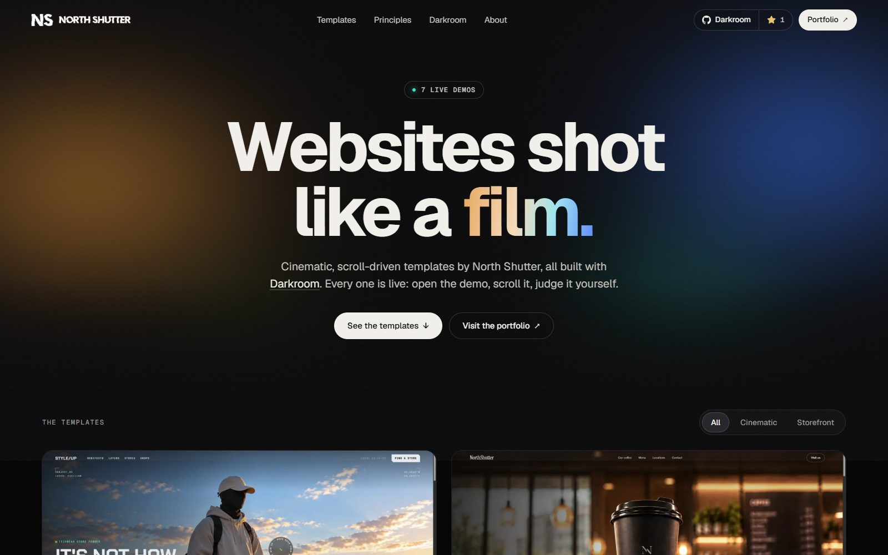</a>
</p>

<p align="center">
  <a href="https://alexandruiftimi-ns.github.io/darkroom-showcase/"></a>
</p>

<p align="center"><b>Seven templates built with Darkroom, all live on free GitHub Pages hosting.</b><br><sub>No screenshots to trust: open any of them and scroll it yourself.</sub></p>

<table>
  <tr>
    <td width="25%" align="center"><a href="https://alexandruiftimi-ns.github.io/darkroom-showcase/style-up/">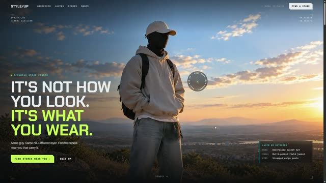</a><br><sub><b><a href="https://alexandruiftimi-ns.github.io/darkroom-showcase/style-up/">Style Up</a></b><br>Storefront · fashion</sub></td>
    <td width="25%" align="center"><a href="https://alexandruiftimi-ns.github.io/darkroom-showcase/coffee-shop/">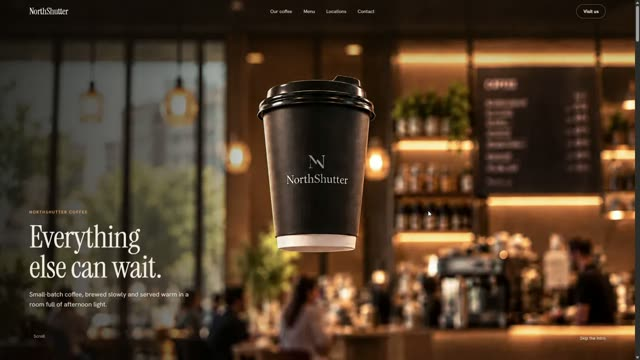</a><br><sub><b><a href="https://alexandruiftimi-ns.github.io/darkroom-showcase/coffee-shop/">Coffee Shop</a></b><br>Storefront · café</sub></td>
    <td width="25%" align="center"><a href="https://alexandruiftimi-ns.github.io/darkroom-showcase/humming-bird/">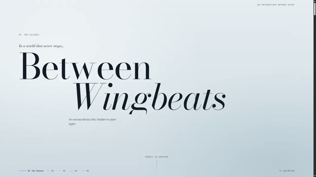</a><br><sub><b><a href="https://alexandruiftimi-ns.github.io/darkroom-showcase/humming-bird/">Humming Bird</a></b><br>Cinematic · story</sub></td>
    <td width="25%" align="center"><a href="https://alexandruiftimi-ns.github.io/darkroom-showcase/nightwatch/">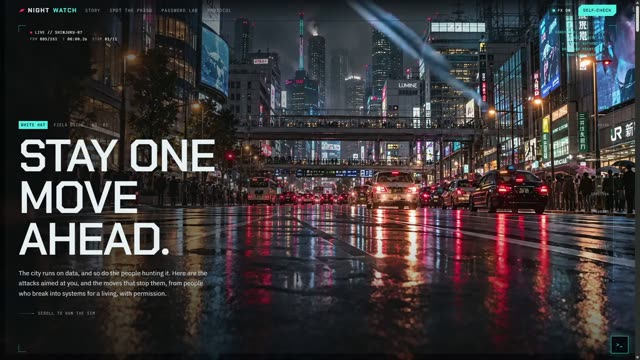</a><br><sub><b><a href="https://alexandruiftimi-ns.github.io/darkroom-showcase/nightwatch/">Nightwatch</a></b><br>Cinematic · education</sub></td>
  </tr>
  <tr>
    <td width="25%" align="center"><a href="https://alexandruiftimi-ns.github.io/darkroom-showcase/maison-solene/"></a><br><sub><b><a href="https://alexandruiftimi-ns.github.io/darkroom-showcase/maison-solene/">Maison Solène</a></b><br>Cinematic · luxury</sub></td>
    <td width="25%" align="center"><a href="https://alexandruiftimi-ns.github.io/darkroom-showcase/iris/">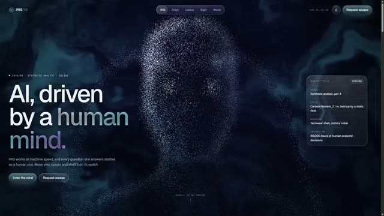</a><br><sub><b><a href="https://alexandruiftimi-ns.github.io/darkroom-showcase/iris/">IRIS/09</a></b><br>Cinematic · WebGL</sub></td>
    <td width="25%" align="center"><a href="https://alexandruiftimi-ns.github.io/darkroom-showcase/little-gills/">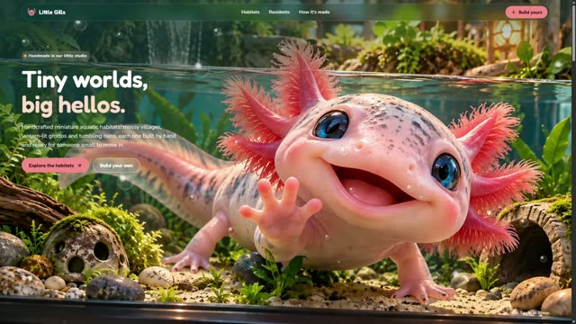</a><br><sub><b><a href="https://alexandruiftimi-ns.github.io/darkroom-showcase/little-gills/">Little Gills</a></b><br>Storefront · aquariums</sub></td>
  </tr>
</table>

> [!TIP]
> **Take the prompt behind a demo.** Each card on the showcase has a **Copy prompt** button. It copies the full build prompt for that template: the slots for your own photos and video, every design value, the copy and the checks to run. Paste it into your coding agent and swap in your own media. Five templates have one so far (Style Up, Coffee Shop, Maison Solène, IRIS/09, Little Gills); on the others the button says the prompt is not available yet.
>
> **Assets are still in progress.** The **Assets** button will hand you the media for each template. It is not ready yet, so for now it tells you the files are on the way.

---

<a id="platforms"></a>

## 🧱 Build it anywhere

One design, ten platforms. Darkroom keeps **dated notes on every platform** and re-reads the **official documentation** when those notes are more than a month old (the platforms change every few months; the live docs win over its notes), asks the questions that platform needs, and puts your colours and fonts **where you can change them later**: in Shopify's theme settings, in WordPress's Styles panel, in one CSS file.

<table>
  <tr>
    <td align="center" width="20%"><br><b>Shopify</b><br><sub>Online Store 2.0 theme: sections, theme blocks, product, collection, cart</sub></td>
    <td align="center" width="20%"><br><b>WooCommerce</b><br><sub>block theme with shop and product templates, or the default theme restyled</sub></td>
    <td align="center" width="20%"><br><b>WordPress</b><br><sub>block theme with <code>theme.json</code>, patterns you can edit</sub></td>
    <td align="center" width="20%"><br><b>Astro</b><br><sub>multi-page site, free on Cloudflare Workers</sub></td>
    <td align="center" width="20%"><picture><source media="(prefers-color-scheme: dark)" srcset="assets/icons/nextdotjs-light.svg"></picture><br><b>Next.js</b><br><sub>React site on Vercel, or a static export anywhere</sub></td>
  </tr>
  <tr>
    <td align="center"><br><b>Hugo</b><br><sub>blogs, docs, big content sites; one binary</sub></td>
    <td align="center"><br><b>Jekyll</b><br><sub>a blog or portfolio GitHub Pages builds for you</sub></td>
    <td align="center"><picture><source media="(prefers-color-scheme: dark)" srcset="assets/icons/ghost-light.svg"></picture><br><b>Ghost</b><br><sub>publication or newsletter with paid members</sub></td>
    <td align="center"><br><b>PHP</b><br><sub>shared hosting, with a safe contact form</sub></td>
    <td align="center"><br><b>Plain HTML</b><br><sub>one page or a few: fast, free to host, nothing to install</sub></td>
  </tr>
</table>

<p><b>Host it free</b> 🆓 &nbsp;


</p>

Darkroom tells you the catch before you pick one (GitHub Pages and Vercel's free plan are for non-commercial sites) and writes the deploy steps in plain words.

<details>
<summary>🧭 <b>Not sure which platform? This is how Darkroom recommends one</b></summary>

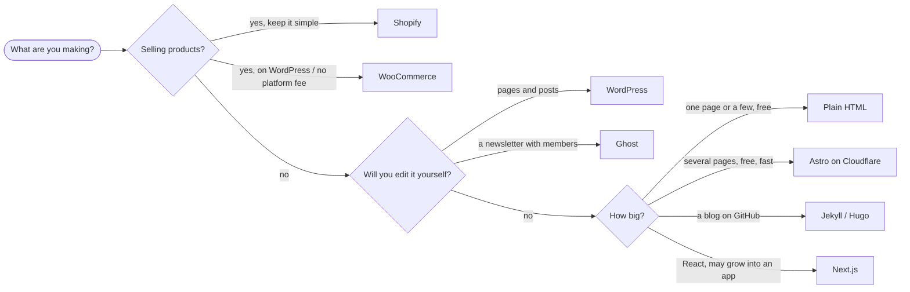

If you already named a platform, it uses yours and only mentions the catch, if there is one.
</details>

<details>
<summary>🔒 <b>On Wix, Squarespace, Webflow or Framer?</b></summary>

Those are closed editors: no tool can import a theme into them as code. Darkroom says so up front and gives you a **design kit** instead: the approved screens, the palette with hex codes, fonts, sizes, section order, copy and every asset sized and named, plus the small CSS or embed snippets each builder accepts. Or it builds the site on a free platform you own.
</details>

---

<a id="redesign"></a>

## ♻️ Start from your current site

Already have a site? Give Darkroom its **address** or its **folder on your computer**, right in the first message:

```text
/darkroom redesign https://mybakery.com as a Shopify store, warm and handmade
```
```text
/darkroom here is my current site: D:\sites\bakery. Make it a WordPress theme I can edit.
```

It asks whether the site is yours and what to bring over (**texts and images**, only texts, or only images), lists your pages so you can pick, then imports them: every text in reading order, your menu, phone, email and social links, and every picture **with its real size**. You get a plain list of what could be sharper (*"900 px wide: fine where it was, soft as a full-width hero"*), never a rejection. It also keeps a list of your old page addresses, so your Google ranking survives the move. Plain HTML, PHP and Markdown folders work; a theme folder (WordPress, Shopify) holds no content, so it asks for the live address instead.

- 🔎 **It sees what your site is built with** (e.g. *WordPress · Kadence theme · Kadence Blocks · TranslatePress*) and recommends **staying there**, so your posts, plugins and rankings stay put. If your pages use a page builder (Elementor, Divi, Kadence…), it suggests restyling your current theme instead of swapping it, because a new theme can break builder pages. Not sure what you use? Pick **"I don't know: check for me"**.
- 🧭 **It decides where to build the first design, and tells you the cost.** Restyling your Shopify or WordPress theme? It works in the theme from the start. A new theme it can't run yet? A quick HTML preview first, rebuilt on the platform after you approve.
- 📄 **Every page, or the home page first.** For sites with several pages it asks: *home page first, approve, then the rest* (saves your usage), *one page first*, or *the whole site now*. An import that finds nothing (some sites block all crawlers but Google) stops and tells you why; it never builds just the home page by accident.

- 📱 **See it on your phone.** At the first preview, Darkroom offers to open the site on your phone over **the same Wi-Fi**: nothing to install, nothing public. Want to send it to someone? It can make a shareable link too, after it asks.
- 📥 **Drop your files in.** Put your photos and clips in the folder and say so. Darkroom checks each one against what it asked for, tells you what could be even better, and asks *"continue with these, or replace any first?"*. **Nothing gets rejected.**

---

<a id="questions"></a>

## 💬 It asks before it builds

<p align="center"></p>

One message, at most four questions, **each with a recommended answer**, and nothing the folder or your message already answered. A second round asks only what is still open: the platform's own questions (*"new Shopify theme or restyle your current one?"*, *"which payments?"*), the goal of the page, **how much to build first** (home page, one page, or the whole site) and how much checking you want:

| | ⚡ Quick check (default) | 🔬 Full check |
|---|---|---|
| **What is captured** | home page + the page that earns you money (a product, pricing, contact), desktop + phone | every template, desktop + tablet + phone, motion on and off |
| **What is audited** | those two pages | every template, plus hover, menus and a cart with an item |
| **Platform validator** | structure check | structure check + the platform's own tool (Theme Check, gscan, a real WordPress) |
| **Why choose it** | uses less of your Claude plan | before a launch |

### 🎨 Colours, your way

<p align="center">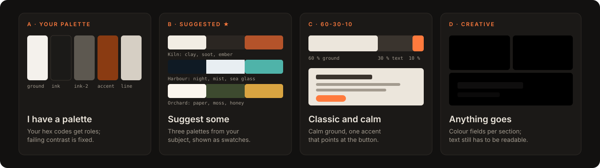</p>

Bring your brand colours, let Darkroom **suggest three palettes drawn from your subject** (shown as swatches, not hex lists), go **classic and calm with 60-30-10** (most of the page calm, one colour pointing at the button), or go **creative** with colour fields per section. Whatever you pick, text contrast is measured on the real page.

### 📸 Your photos, or prompts for AI tools

Have your own pictures and video? Darkroom designs around them. Don't? It writes **ready-to-paste prompts** for the tools you use, says which mode to use, what to attach, how to tell a good result from a bad one, and what ships if the asset never arrives. It never spends your credits. Prefer free media? Darkroom suggests sources (free photo and video libraries, AI-made clip libraries, or a moving backdrop drawn in code, which loads faster than video) and **uses whichever you pick**.

| Mode | Use it for | Tools it writes prompts for (examples) |
|---|---|---|
| 🖼️ Text to image | hero plates, atmosphere, textures | ChatGPT image generation, Midjourney, Gemini / Imagen, Flux, Firefly |
| 🪄 Image edit | cleaning your real product photo, new background | ChatGPT, Gemini |
| 🎞️ Image to video | your product turning, a camera move into a still | Kling, Veo 3, Seedance, Runway, Luma |
| 🎬 Text to video | a mood loop, a place, a background film | Veo 3, Kling, Seedance, Sora |
| 🧷 First and last frame | a transition that must start and end exactly (scroll scrubs) | Kling, Veo 3 |

---

<a id="looks"></a>

## ✨ Any look × any motion

Every project is **three choices**: where it lives, how it **looks** and how it **moves**. Darkroom reads all three from your message and says them back in one line (*"A Shopify theme, a Cartier-like look, things appear as you scroll. No scroll story."*).

### How it looks: a style, or "like a brand you love"

<p align="center"></p>

Say *"like apple.com"*, *"like Rolex"* or *"like Cartier"*: Darkroom measures the live site (type sizes, spacing, rhythm, palette roles, motion) and applies that **design language** to *your* brand. It never copies their logo, photos, text or font files, and it checks that nobody could mistake your site for theirs.

<details>
<summary>🎭 <b>Or pick one of 14 style packs</b> (each changes the rules, so a luxury page and a bold page are not judged the same way)</summary>

| Pack | Feels | Typical use |
|---|---|---|
| Cinematic | immersive, filmic, dramatic | product launches, film, cars, hardware |
| Luxury | quiet, rare, slow | fashion, jewellery, hotels, real estate |
| Modern | clear, precise, current | SaaS, tools, startups, studios |
| Bold | loud, confident, poster-like | campaigns, sport, music, agencies |
| Cyberpunk | neon noir, tech, edge | gaming, events, nightlife |
| Editorial | informed, structured | magazines, reports, journals |
| Restaurant | appetite, place, hospitality | restaurants, bars, cafés, bakeries |
| Catalog | browsable, trustworthy, fast | product ranges, rentals |
| Nature | calm, grounded, alive | outdoor, wellness, farms |
| Art gallery | the work first | artists, galleries, photographers |
| Artsy | experimental, playful, colourful | creative studios, festivals, illustrators |
| Family | warm, safe, easy | kids, schools, community |
| Trust | credible, calm, competent | finance, legal, medical, B2B |
| Glass cinema *(on request)* | dark, frosted, a film behind everything | AI launches, studios, events: when you want to fit that crowd, not stand out |

</details>

> [!NOTE]
> **Darkroom's home ground is modern and editorial-modern.** Ask for retro, quirky or hand-made and it says so in one line, then builds it anyway if that is what you want.

### How it moves: four levels

<p align="center"></p>

| Level | Visitors see | You provide |
|---|---|---|
| 🧘 **Calm** | a still, composed page; hover and focus states only | nothing extra |
| 🌊 **Animated** | headings rise, text fades in, pictures open as you scroll | nothing extra |
| 💥 **One hero effect** | one memorable moment (a product that turns, a dive into a lens), then a normal page | usually one clip or one strong image |
| 📖 **Scroll story** | chapters on a pinned stage; scroll back to replay | a few sentences per chapter, plus the media each one needs |

<details>
<summary>🎞️ <b>Scroll story, "moves as I scroll", or an AI film? Three different things</b></summary>

| You ask for | Darkroom builds | An AI film? |
|---|---|---|
| **A scroll story** | chapters told with your own words, pictures, type and effects | at most one ingredient, never the whole story |
| **"Something that moves as I scroll"** | picks from the effect menu: frames that follow the scroll, parallax, reveals, a pinned scene… | one option among several |
| **"Like those AI websites" / "with Kling or Veo"** | a film made of chained AI clips, scrubbed by scroll | yes, with its own rules: one look locked from the first still, each clip starting exactly where the last one ended, every join scored, and a light first screen |

</details>

**Smooth on phones.** Scroll films keep their frames in memory, prepare the next ones in the direction you scroll, never flash a frame from the wrong place on a fast flick, and ignore the phone's address bar growing and shrinking. Pauses on key moments are built into the film; the page never scrolls by itself. Smooth-scroll libraries stay off on touch screens.

Every effect has a reduced-motion version and works without JavaScript. Which library suits which job (GSAP, Motion, Lenis, three.js, Lottie, CSS scroll animations): [`motion-toolkit.md`](skill/darkroom/references/motion-toolkit.md).

---

<a id="prompts"></a>

## 🗣️ Try these prompts

Open Claude Code in an empty folder (or your project) and type one. Click a group to open it.

> [!TIP]
> **📚 100 more example prompts in [`skill/darkroom/examples/`](skill/darkroom/examples/INDEX.md)**: a bakery, a dental practice, a Ghost magazine, a WooCommerce furniture shop, a festival line-up, a school, a food bank, a type foundry, a site redesign, an "apple.com-like" product page and 90 others, on all ten platforms. Each has a request to copy (change the details to your business) and the full build spec Darkroom would write, so you can see exactly what you'll get. These are prompts and specs, not finished sites: Darkroom builds yours when you ask.

<details open>
<summary>🛒 <b>Shops</b></summary>

```text
/darkroom a Shopify store for my handmade ceramics, quiet and expensive like Cartier. 14 product photos are in ./photos
```
```text
/darkroom a WooCommerce shop for my coffee roastery on my existing WordPress site, warm and handmade
```
**What happens:** it checks its notes on Shopify or WooCommerce (and the official docs if they are over a month old), asks the few store questions that matter (new theme or restyle, payments, how many products), then shows you two coded versions of the home page.
</details>

<details>
<summary>♻️ <b>Redesign what you have</b></summary>

```text
/darkroom redesign https://mybakery.com. Keep my texts, make it feel like a Lisbon pastry shop. Same platform.
```
```text
/darkroom my old site is in ./old-site (plain HTML). Move it to Astro on Cloudflare and make it modern.
```
**What happens:** it asks whether the site is yours and what to bring over, lists your pages, imports them, and tells you which photos could be sharper. Then it shows two new directions using your own words.
</details>

<details>
<summary>📝 <b>Sites you edit yourself, blogs and newsletters</b></summary>

```text
/darkroom a WordPress site for my physiotherapy practice that I can edit myself. Calm, trustworthy, suggest colours.
```
```text
/darkroom a Ghost theme for my design newsletter with paid members. Editorial, black and white.
```
```text
/darkroom a Hugo blog for my travel photography, the photos first
```
</details>

<details>
<summary>🆓 <b>Free to host</b></summary>

```text
/darkroom a one-page site for my band I can host for free. Bold and loud, animations on scroll.
```
```text
/darkroom an Astro site on Cloudflare for my architecture studio: home, projects, about, contact
```
```text
/darkroom a portfolio on GitHub Pages with Jekyll. I'm a motion designer; write me Kling prompts for the hero.
```
</details>

<details>
<summary>💥 <b>Big effects</b></summary>

```text
/darkroom here is my product video (./assets/turn.mp4). Make the product turn as people scroll.
```
```text
/darkroom I want scroll storytelling for my coffee roastery: from the farm to the cup. What do you need from me?
```
**What you get first:** a chapter plan and a "what I need from you" list. Each item says the best way to make it (your phone, Blender, an AI tool, with the prompt), the cost class, and what ships if it never arrives.
</details>

<details>
<summary>🎞️ <b>The AI-film look, on request</b></summary>

```text
/darkroom a landing page for my perfume brand like those AI motion websites: one continuous film as you scroll, from the bottle on a dune at dawn into a night garden. I'll make the clips in Kling, write me the prompts.
```
**What happens:** it locks one look from a first still, writes a prompt per clip where each clip starts on the exact last frame of the one before, waits for your clips and picks them up as they land, joins them into one film, tells you which join jumps and how to fix it, and keeps the first screen light enough to load fast on a phone.
</details>

<details>
<summary>🎬 <b>Showpiece launches</b></summary>

```text
/darkroom a product launch page for our open-back headphones: as you scroll, the headphones come apart into their parts (driver, grille, pads, headband) floating in space, then come back together. Black background, very precise. Pre-order.
```
```text
/darkroom a product page for our e-reader that looks like apple.com: huge product shots, big short headlines, the device turning as you scroll, then features one by one. But it has to be clearly our own brand, not a copy.
```
```text
/darkroom a B2B landing page for our drone survey company: as you scroll, an aerial photo of a building site turns into the 3D measurement map we deliver, with contour lines and numbers appearing. Then services, accuracy, and a quote request.
```
**See the full specs:** [headphones](skill/darkroom/examples/064-aural-one-headphones.md) · [e-reader](skill/darkroom/examples/100-folio-ereader-like-apple.md) · [drone survey](skill/darkroom/examples/097-overhead-drone-survey.md)
</details>

<details>
<summary>🌲 <b>Travel, places and stories</b></summary>

```text
/darkroom a booking site for forest cabins. In the hero you can switch the view between four moods (morning mist, rain, snow, firelight), the videos crossfade, and the cabin window frame stays in front of them. Book a stay.
```
```text
/darkroom a scroll story for our mountain guiding company: one classic route told day by day as you scroll, the altitude line drawing itself, and the photos of each day. Then all our trips with levels and dates. Book a trip.
```
```text
/darkroom a landing page for a sleeper train that runs above the Arctic Circle in winter. Two full-screen parts: first the train under the northern lights, then inside the cabin. Both with looping video. Book a berth.
```
**See the full specs:** [cabins](skill/darkroom/examples/016-fernhollow-cabins.md) · [mountain guides](skill/darkroom/examples/072-high-col-mountain-guides.md) · [night train](skill/darkroom/examples/006-polar-night-rail.md)
</details>

<details>
<summary>🏪 <b>Everyday businesses</b></summary>

```text
/darkroom a one-page site for my sourdough bakery in Lisbon: what we bake each day, opening hours, where we are, and pre-order for Saturday. Warm, floury, not cutesy. Free hosting.
```
```text
/darkroom a website for our dental practice on our PHP hosting. Calm, reassuring, not clinical-cold. New patients should find prices, the emergency number and the booking form fast. We have photos of the team and the rooms.
```
```text
/darkroom a WooCommerce site for our independent bookshop: staff picks with a handwritten-note feel, an events calendar for author readings, and you can order books for collection or delivery.
```
**See the full specs:** [bakery](skill/darkroom/examples/041-crumb-and-kiln-bakery.md) · [dental practice](skill/darkroom/examples/044-brightside-dental.md) · [bookshop](skill/darkroom/examples/049-the-margin-bookshop.md)
</details>

<details>
<summary>🎨 <b>Creative and loud</b></summary>

```text
/darkroom a loud, colourful site for our forest music festival: the line-up as huge type in different sizes by billing, each day with its own colour, tickets with tiers, and practical info. It should feel like the poster.
```
```text
/darkroom a launch page for our indie game: a hand-painted world with layers that move a little with the mouse, the trailer, wishlist buttons, screenshots, and a press kit link. It should feel like the game, not like a tech site.
```
```text
/darkroom a website for our small type foundry: each typeface gets a big type tester where you can type your own words and change size and weight, a specimen page, and licence prices for desktop and web.
```
**See the full specs:** [festival](skill/darkroom/examples/054-fernwave-festival.md) · [indie game](skill/darkroom/examples/083-lanternfall-indie-game.md) · [type foundry](skill/darkroom/examples/096-glyphwell-type-foundry.md)
</details>

<details>
<summary>🤝 <b>"You decide"</b></summary>

```text
/darkroom a landing page for my dog-walking service. Just go: you decide everything, show me the result at the end.
```
```text
/darkroom just a quick hero concept for my candle shop, dark and warm
```
**What happens:** the fast lane. No questions: one file, built, screenshotted and shown, then the offer to turn it into the full site.
</details>

<details>
<summary>🤖 <b>Building in Lovable, v0, Bolt or Cursor</b></summary>

```text
/darkroom write me a Lovable prompt for a landing page for my yoga studio, calm and natural
```
**What you get:** one prompt in that tool's format, with every value spelled out and a "do not" list at the end. Paste it in; send Darkroom the preview link and it checks the result like any other page.
</details>

---

<a id="how-it-runs"></a>

## ⚙️ How a project runs

<p align="center">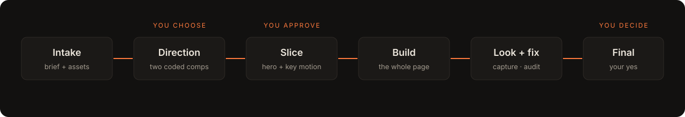</p>

You are asked at **four moments only**: the first questions, choosing between two directions, approving a working slice, and the final result. If you chose *home page first*, it asks once more before building the other pages. Everything between is Claude's job, and you can say "just go" at any time. The preview stays open and **reloads by itself** at the same scroll position while Darkroom works (a colour or spacing change updates without a reload at all).

<details>
<summary>🔍 <b>What happens at each stage</b></summary>

| Stage | What happens |
|---|---|
| **Intake** | Reads your message, assets, references and your current site (what it is built with); re-checks the platform's docs when its notes are over a month old; decides where to build the first design; asks one or two rounds of questions. |
| **Direction** | Finds the one idea of the site and codes two versions of the first screen, with real copy, on desktop and phone. |
| **Slice** | Writes the build spec (every value, matched against the two closest examples), then builds the first screen, its key motion and the transition into the next section, working, on the real platform when it can run locally. |
| **Build** | Writes the rest of the pages and templates from a short design bible: palette, type, motion, copy budgets. |
| **Check + fix** | Captures real browser states, runs the audits and the platform's validator, scores the page through ten lenses, fixes what shows up. |
| **Final** | You review. Nothing is called done without a capture of the current build, and the deploy steps are written for you. |

</details>

<a id="changes"></a>

<details>
<summary>✏️ <b>Changing your site later</b></summary>

**Same session:** just type in chat. Once `/darkroom` has run, its rules stay loaded, so "make the hero darker" or "swap the font" goes through the same build, screenshot and fix loop.

```text
make the hero darker and the headline shorter
the pricing cards feel crowded on my phone, fix that
```

**New session, or after `/clear`:** start with `/darkroom` again. The project's state is saved in its `.darkroom/` folder, so it picks up where you left off.

```text
/darkroom change the pricing section on my landing page: three plans instead of two
```

Without `/darkroom`, Claude still edits your files, but as plain Claude: no Darkroom design rules, no browser check.

> [!TIP]
> Want Darkroom to start on its own whenever you ask for design work? Delete the line `disable-model-invocation: true` from `skill/darkroom/SKILL.md`, reinstall and restart. The catch: it may also start when you didn't want it.

</details>

---

<a id="proof"></a>

## ✅ Checked, not guessed

Every starter theme was run through **the platform's own tools**, not just Darkroom's:

| Platform | Validated with | Result (2026-10-26) |
|---|---|---|
|  Shopify | Shopify Theme Check | **24 files, 0 offenses** |
| <picture><source media="(prefers-color-scheme: dark)" srcset="assets/icons/ghost-light.svg"></picture> Ghost | gscan | **compatible with Ghost 6.x** |
|  WordPress | a real WordPress (Playground), Site Editor block validation | **renders; 0 invalid blocks** in every template |
|  WooCommerce | WordPress + WooCommerce from wordpress.org, sample products | **shop and product pages render; 0 invalid blocks** |
| All ten | Darkroom's structure check + **127 automated tests** | passing locally; run before every release |

That run found real problems before you could: WooCommerce blocks that look self-closing but save HTML (the editor would have called them broken), missing side padding on phones, and new WooCommerce stores hiding behind "Coming soon". All fixed, and the checks now catch them.

<details>
<summary>🧪 <b>Everything the skill can do</b></summary>

| | |
|---|---|
| 🎨 **Art direction** | 14 style packs, a build spec with every value before the code, 100 example prompts to match (each with its full spec), looks inspired by brands you name, and 228 reviewed real sites it can look up by technique ("a scroll story like ScrollTide", parallax, a cursor effect, chained AI clips), the newest 89 judged separately on design, build and technique. |
| ♻️ **Redesign** | imports your current site (URL or folder): texts, menu, contacts, images with sizes, old addresses. |
| 📱 **Phone preview** | your site on your phone over the same Wi-Fi, or a shareable link when you say yes. |
| 📥 **Asset check** | measures what you drop in, suggests improvements, never rejects. |
| 🧱 **Ten platforms** | dated profiles with the official docs to re-check, starters, a structure check, deploy steps. Building in Lovable, v0, Bolt or Cursor? Darkroom writes the prompt for that tool and checks the builder's preview. |
| 🌊 **Scroll and motion** | 35 tested building blocks: background video that never flashes, seamless loops, readable text over video, headline entrances, menus, buttons, grain, marquees, count-ups, word-by-word reveals, stacking cards, typewriter and rotating words, full-width wordmarks, phone swipe rails, magnetic buttons, parallax layers, spotlights, a depth carousel, frosted glass, mood-clip switchers, shader backdrops, a draggable 3D model, reveals, scroll-scrubbed video, frame sequences that stay smooth on a fast phone flick (with a lighter set for phones), pinned scenes, characters that come alive per section, and an image that reveals another under your cursor. Every one has a reduced-motion fallback. |
| 📷 **Real-browser QA** | Playwright captures at several screen sizes, contact sheets and crops, motion on and off (also pages that scroll inside their own box or only on the mouse wheel); each run records the build it was taken from. A live preview that reloads by itself while Darkroom works. |
| 🔎 **Audits** | 41 checks, each marked measured, heuristic or manual: accessibility, contrast from real pixels, clutter, word budgets, type scale, colour, keyboard, reduced motion, white flash on load, hidden headlines, videos that don't play or jump on loop, fonts that didn't load, see-through frames in scroll films, films that jump on a fast phone flick, pages that scroll by themselves, dead stretches of scroll, the same frosted caption box in every chapter, "best viewed on desktop" screens, a small headline lost over full-screen film, too much weight before the first scroll, and chained clips that jump at the join. |
| ⚖️ **Compliance checklist** | EU and US checklists for cookies, prices, disclosures and AI-image labelling. A checklist, not legal advice. |
| 🎞️ **Media** | probes media, makes responsive images, turns video into a frame sequence, makes videos web-ready (desktop, phone, still frame), measures edge colour and loop jumps, joins chained AI clips into one film and scores every join, and draws free moving backdrops in your colours (8 styles + 3 textures). |
| ✍️ **Image and video prompts** | for ChatGPT, Midjourney, Kling, Seedance, Veo and others, with acceptance criteria. |

</details>

---

<a id="knowledge"></a>

## 📚 Where the knowledge comes from

<p align="center"></p>

Darkroom is **not a trained model**. It is written knowledge that Claude reads while it works, in plain files you can check: **inspiration from 228 real website designs** (kept as written lessons, never screenshots or copied code; the newest 89 are AI-made and AI-motion sites, each judged on design, build and technique separately), **32 lessons** of which **13 became rules** after the author approved them, **29 research sources** (Nielsen Norman Group, WCAG 2.2, the European Accessibility Act, EU cookie and price rules, the AI Act), the **official docs of all ten platforms**, **100 example prompts**, each with the full build spec it leads to (every font, size, colour and timing), which Darkroom reads before designing yours, **35 motion and media recipes** each tested in a real browser, **Values tables** for type, motion, spacing and colour, and the author's own taste calls. **127 automated checks** run on every change, so a rule that stops working gets noticed.

**[→ The full list: every site, source and human decision](KNOWLEDGE.md)**

---

<a id="install"></a>

## 🚀 Install

Requires [Claude Code](https://claude.com/claude-code) and Node 18+. Two ways, same skill:

**As a plugin** (easiest; updates with one command). Inside Claude Code:

```text
/plugin marketplace add alexandruiftimi-ns/darkroom
/plugin install darkroom@darkroom
```

Or from your shell: `claude plugin marketplace add alexandruiftimi-ns/darkroom`, then `claude plugin install darkroom@darkroom`. Update later with `claude plugin update darkroom@darkroom`. Plugin commands carry the plugin's name, so you type **`/darkroom:darkroom`**.

**As a plain skill** (you type **`/darkroom`**): copy the `skill/darkroom/` folder into `~/.claude/skills/` (all your projects) or `.claude/skills/` in one project. Pick one way, not both, or Darkroom shows up twice.

1. **Restart Claude Code.**
2. For screenshots and audits, Darkroom needs Playwright: `npm i -D playwright && npx playwright install chromium` in your project, or a global install. On Windows it can use the Edge browser you already have. ffmpeg is optional.
   Not sure what you have? `node ~/.claude/skills/darkroom/scripts/darkroom.mjs doctor` (plugin installs: ask Claude to run Darkroom's doctor) checks and prints the exact command for anything missing.
3. Type `/darkroom` (plugin: `/darkroom:darkroom`) and describe your site.

Platform tools (Shopify CLI, WordPress Playground, gscan, Astro, Hugo) are free, and Darkroom asks before it downloads any of them. To remove Darkroom: `claude plugin uninstall darkroom@darkroom`, or delete the copied `darkroom` folder.

<details>
<summary>📁 <b>What is inside the repository</b></summary>

The skill is plain Markdown playbooks plus small Node scripts. There is no build step.

| Folder | Purpose |
|---|---|
| `skill/darkroom/SKILL.md` | the flow and the rules Claude follows |
| `skill/darkroom/commands/` | one playbook per stage (intake, style, platform, build, audit…) |
| `skill/darkroom/platforms/` | one dated profile per platform, with the official docs to re-check |
| `skill/darkroom/scripts/` | `darkroom.mjs`: capture, audit, platform, media, assets, state |
| `skill/darkroom/templates/platforms/` | the starter for each platform |
| `skill/darkroom/references/` | colour, asset tools, modes, looks, motion toolkit, craft, compliance… |
| `skill/darkroom/examples/` | 100 example requests, each with the full build spec Darkroom would write |
| `skill/darkroom/styles/`, `library/`, `prompts/`, `recipes/` | style packs, written lessons from real sites, model prompts, tested motion code |
| `skill/.claude-plugin/plugin.json`, `.claude-plugin/marketplace.json` | what makes the same skill installable as a Claude Code plugin |

Only `skill/darkroom/` is installed.

</details>

## Honest limits

- **Landing pages are the most tested.** Shops, blogs and multi-page sites follow the same process with platform rules on top; web apps and dashboards are out of scope.
- Platforms change often. Darkroom re-reads the official docs when its notes are over a month old, and its notes carry a date; a change it has not seen can still surprise it.
- Building a shop is not running one: payments, tax, shipping and legal pages need your accounts and your decisions.
- Heuristic checks are questions, not verdicts. The compliance checklist is not legal advice.
- Darkroom raises the floor and the process. It cannot promise a site "worth $10,000"; the result depends heavily on the assets you supply. Your eye is the judge.

## Licence

[MIT](LICENSE) © 2026 Darkroom contributors. Example fonts: SIL OFL 1.1. Platform logos come from [Simple Icons](https://simpleicons.org) (CC0); the names and logos are trademarks of their owners, shown only to say which platforms Darkroom builds for. Darkroom is not affiliated with or endorsed by any of them.
